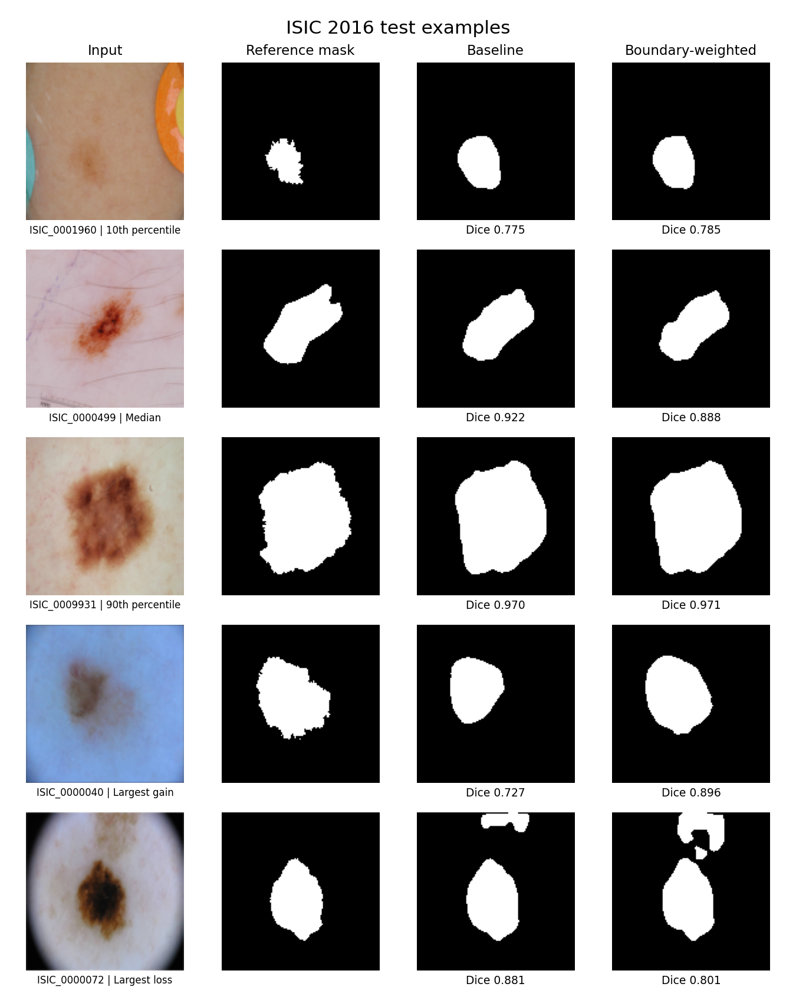
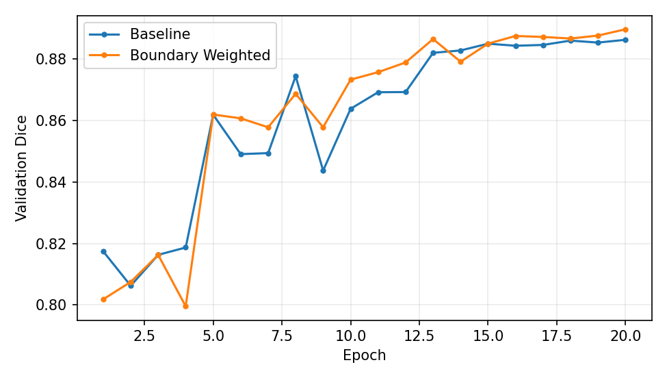

# 病变边界加权损失在轻量 U-Net 皮肤镜图像分割中的对照实验

本实验输入一张 RGB 皮肤镜图像，输出一张二值掩膜。掩膜中的白色表示预测为病变区域。两组均从随机初始化在 CPU 上训练，实验变量为 BCE 中边界附近像素的权重。

## 数据与划分

使用 ISIC 2016 官方下载页的 Part 3B 图像与配套二值掩膜，共 900 张训练候选图像、379 张官方测试图像。这里只使用分割掩膜。按图像 ID 和 JPEG 原始字节 SHA-256 检查训练与测试之间的重复，剔除 3 张训练图像，保留完整的官方测试集。在剩余 897 张训练候选图像中，用种子 42 划出 90 张验证图像和 807 张训练图像。具体编号见 `results/split.json`，跨集合重复项见 `results/summary.json`。该检查覆盖完全相同的文件。另有一对完全相同的 JPEG（ISIC_0001442 与 ISIC_0001742）都在本次训练集中，按原样保留且未进入验证集或测试集。实验仍缺少患者级分组与系统性的近重复审计。

RGB 图像以双线性插值缩放为 128×128，像素归一化到 [0, 1]。掩膜用最近邻插值缩放，再按灰度值 128 二值化。训练时对图像和标签同步随机水平、垂直翻转。

## 对照方法

- **Baseline** 使用轻量 U-Net 与等权重的逐像素二元交叉熵（BCE）加 soft Dice 损失。
- **边界加权组** 保持同一个网络和 soft Dice 项。由训练标注掩膜做 3×3 膨胀减去腐蚀，得到跨越轮廓内外的窄带。窄带内的 BCE 权重为 3，其他像素为 1。每张图的加权 BCE 以该图像所有权重之和归一化。权重 3 是本次预先设定的单个实验值。

两组使用相同的初始参数、样本划分、批次顺序、翻转序列与训练预算。Adam 的初始学习率为 0.001，余弦下降到 0.0001，批大小为 12。每组训练 20 轮，以验证集逐图平均 Dice 最高的那轮保存权重。测试时概率阈值固定为 0.5，未进行后处理。

区域指标 Dice 和 IoU 衡量预测与标注的区域重叠。Boundary F1 将掩膜减去其 3×3 腐蚀结果得到内侧轮廓，用双向欧氏距离不超过 2 个像素来定义匹配，再取边界精确率和召回率的调和平均。三个指标在 128×128 分辨率上逐图计算，然后对测试图像等权平均。配对 bootstrap 对测试图像重采样 5000 次，用于描述这两个已训练模型在该测试样本上的差值波动。

## 实验结果

下表为 379 张官方测试图像的逐图平均分。差值为边界加权组减去基线，换算为百分点。

| 指标 | Baseline | 边界加权 | 差值（百分点） | 差值 95% 配对 bootstrap 区间（百分点） |
|---|---:|---:|---:|---:|
| Dice | 0.8841 | 0.8868 | +0.26 | [+0.06, +0.48] |
| IoU | 0.8110 | 0.8145 | +0.35 | [+0.07, +0.65] |
| Boundary F1 | 0.5905 | 0.6011 | +1.06 | [+0.29, +1.81] |

边界加权组的三个平均指标均上升，其中 Boundary F1 的增幅最大。逐图看，Boundary F1 有 206 张上升、159 张下降、14 张持平。区域 Dice 有 204 张上升、174 张下降、1 张持平。平均增益伴随明显的样本差异。

预测对比图中，ISIC_0000040 的基线掩膜遗漏了标注右侧的部分区域，边界加权后覆盖更完整，Dice 从 0.727 升至 0.896。ISIC_0000072 的两组预测均在图像顶部出现额外区域，加权后该区域更大，Dice 从 0.881 降至 0.801。这两张是按 Dice 最大升幅和最大降幅选出的例子，另展示了基线的第 10、50、90 百分位样本。

两个模型各含 67,569 个可训练参数，均在第 20 轮达到最高验证 Dice。Intel Xeon Platinum 8370C 上使用 4 个 PyTorch CPU 线程，训练循环分别约耗时 248 秒和 258 秒。运行时间会随设备和系统负载变化。

本次比较只用一个训练种子、一个边界权重和一个数据集。测试图像的重采样区间只描述这两份已训练权重的差异，跨随机种子、原始分辨率或其他数据集的效果仍需另行验证。





## CPU 复现

推荐 Python 3.12。在项目根目录打开终端。Windows PowerShell 中可用 `py -3.12 -m venv .venv` 创建环境，并以 `.venv\Scripts\python.exe` 替换下方每一行开头的 `python`。

```bash
python -m pip install torch==2.6.0 --index-url https://download.pytorch.org/whl/cpu
python -m pip install -r requirements.txt
python prepare.py
python experiment.py --out reproduced_results
```

`prepare.py` 会下载约 843 MiB 的官方 ZIP。也可以先把官网 Part 3B 的训练、测试压缩包分别另存为 `data/Training.zip` 和 `data/Test.zip`，再运行脚本。压缩包的 SHA-256 见 `DATA_SHA256.txt`。准备完成后生成约 80 MiB 的数据缓存。Windows 可在 PowerShell 中直接逐行运行上述命令。

只用随附权重重测时，先运行 `python prepare.py`，再执行 `python experiment.py --evaluate-only`。该操作会重新生成 `results/` 中的指标与图，保留已有模型权重。每次训练使用不同的输出目录，可以保留交付的原始结果。

## 文件

| 路径 | 内容 |
|---|---|
| `prepare.py`、`experiment.py` | 数据准备、训练和评估 |
| `vendor/unet_parts.py` | 来自 GitHub 的网络模块 |
| `results/baseline.pt`、`results/boundary_weighted.pt` | 两组从头训练得到的最佳验证轮权重 |
| `results/summary.json`、`results/test_per_image.csv` | 测试集平均指标、配对差值及逐图记录 |
| `results/history_*.csv`、`results/validation_curves.png` | 两组训练日志与验证曲线 |
| `results/predictions.png` | 原图、标注和两组预测的可视化 |
| `results/split.json` | 训练、验证、测试样本 ID |

## 来源与许可

- GitHub 实现：[milesial/Pytorch-UNet](https://github.com/milesial/Pytorch-UNet/tree/21d7850f2af30a9695bbeea75f3136aa538cfc4a)，GPL-3.0。直接复用该版本的 `DoubleConv`、`Down`、`Up`、`OutConv` 模块，自行组装轻量网络及编写本实验的数据流程、损失和评估。代码按 GPL-3.0 分发，见 `LICENSE`。
- U-Net 原论文：Ronneberger O, Fischer P, Brox T. *U-Net: Convolutional Networks for Biomedical Image Segmentation*. MICCAI, 2015. [arXiv](https://arxiv.org/abs/1505.04597)
- 数据：[ISIC Challenge Datasets](https://challenge.isic-archive.com/data/#2016)。数据来源论文：Gutman D, Codella NCF, Celebi E, et al. *Skin Lesion Analysis toward Melanoma Detection: A Challenge at ISBI 2016, hosted by ISIC*. 2016. [arXiv](https://arxiv.org/abs/1605.01397)
- 边界加权相关工作：[*Boundary guidance network for medical image segmentation*](https://doi.org/10.1038/s41598-024-67554-0)。本实验单独考察固定窄带 BCE 权重，使用独立训练的同结构对照。
- 预测图中的皮肤镜图像和参考掩膜来源于上述 ISIC 官方压缩包，已缩放为 128×128。
